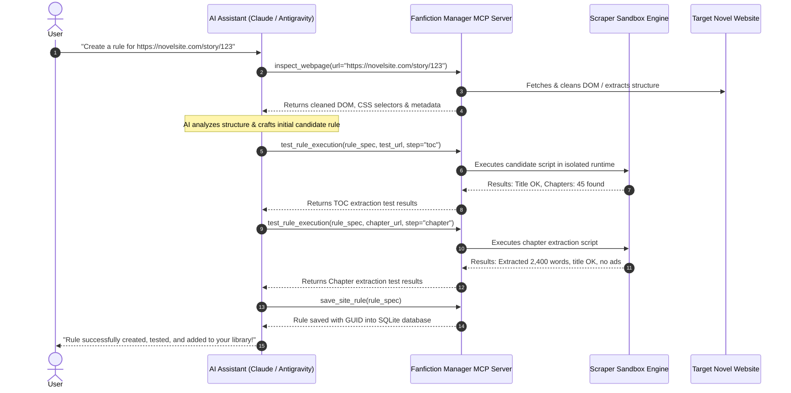

# Version 4 Model Context Protocol (MCP) Specification

## 1. Overview & Vision

Fanfiction Manager Version 4 incorporates a native **Model Context Protocol (MCP) Server**. This allows AI agents (e.g. Claude Desktop, Antigravity, Cursor, or local LLMs) to interface directly with Fanfiction Manager.

Through MCP, an AI assistant can:
1. **Inspect any novel website's live DOM** (sanitized to avoid LLM token overflow).
2. **Automatically generate scraping rules** (`pagetype_code`, `toc_code`, `chapter_code`, `url_regex`).
3. **Execute & Test rules in a live sandbox** against target chapters, receiving immediate structured feedback.
4. **Self-correct and refine selectors** iteratively until extraction accuracy reaches 100%.
5. **Save the finalized rule directly** into the user's library database without requiring manual code entry.



---

## 2. Server Architecture & Transports

The MCP server is implemented natively inside the Rust backend and supports two communication transports:

### 2.1 Standard I/O Transport (`stdio`)
Used for seamless integration with desktop AI hosts (Claude Desktop, Antigravity, Cursor):
```json
{
  "mcpServers": {
    "fanfiction-manager": {
      "command": "fanfiction-manager",
      "args": ["--mcp"]
    }
  }
}
```

### 2.2 Server-Sent Events / HTTP Transport (`SSE`)
Used for local network, mobile, or browser-based AI integrations:
- Endpoint: `http://127.0.0.1:4455/sse`
- Supports real-time streaming of scraping execution and status updates.

---

## 3. MCP Tool Registry

### 3.1 `inspect_webpage`
Fetches a webpage, cleans all noise (advertisements, tracking scripts, tracking pixels, SVG icons), and returns a structured DOM or Markdown outline to preserve context tokens.
- **Parameters**:
  - `url` (string, required): The URL of the novel TOC or chapter page.
  - `render_js` (boolean, optional, default `false`): If true, renders through native headless webview.
  - `format` (string, optional, enum: `["markdown", "sanitized_html", "selector_tree"]`, default `markdown`).
- **Returns**: Cleaned page structure, meta tags, and detected link lists.

### 3.2 `analyze_novel_structure`
Performs automated heuristic detection of:
- Candidate novel title selectors.
- Candidate table-of-contents link containers and pagination patterns.
- Candidate chapter content containers.
- Cloudflare Turnstile / anti-bot presence.
- **Parameters**: `url` (string, required).
- **Returns**: Heuristic score and suggested CSS/XPath selector candidates.

### 3.3 `list_existing_rules`
Supplies the LLM with installed rules to use as few-shot in-context examples.
- **Parameters**: `query` (string, optional - filter by domain/name).
- **Returns**: Array of rule definitions with `url_regex`, `toc_code`, `chapter_code`.

### 3.4 `test_rule_execution`
Executes candidate rule scripts against a live target URL inside the isolated sandbox and returns the parsed output or runtime exceptions.
- **Parameters**:
  - `test_url` (string, required): URL to test against.
  - `rule_spec` (object, required):
    - `url_regex`: regex string.
    - `pagetype_code`: JS evaluation code.
    - `toc_code`: JS evaluation code.
    - `chapter_code`: JS evaluation code.
    - `url_blocks`: newline-delimited blocklist.
  - `step` (string, required, enum: `["pagetype", "toc", "chapter"]`).
- **Returns**:
  ```json
  {
    "success": true,
    "step": "toc",
    "execution_time_ms": 142,
    "output": {
      "Title": "The Wandering Inn",
      "CoverURL": "https://...",
      "ChapterCount": 1240,
      "SampleChapterURLs": [
        "https://.../chapter-1",
        "https://.../chapter-2"
      ]
    },
    "warnings": []
  }
  ```

### 3.5 `save_site_rule`
Validates and persists the new or updated rule into the SQLite database.
- **Parameters**:
  - `rule_spec` (object, required): Complete rule definition.
  - `overwrite` (boolean, optional, default `false`).
- **Returns**: `{ "saved": true, "guid": "...", "rule_name": "..." }`.

### 3.6 `query_library`
Allows the AI assistant to browse, search, and report on novels currently saved in the user's library.
- **Parameters**: `search_term` (string, optional).
- **Returns**: List of novel titles, downloaded chapters, and reading progress.

### 3.7 `trigger_novel_download`
Triggers downloading or updating of a novel from the AI chat interface.
- **Parameters**: `novel_id_or_url` (string, required).
- **Returns**: Queue status and scheduled task info.

---

## 4. Pre-Packaged MCP Prompt Templates

### `generate_novel_rule`
A structured prompt exposed to AI assistants that standardizes the generation workflow:
1. Calls `inspect_webpage` on the TOC URL.
2. Identifies chapter listing schema.
3. Calls `inspect_webpage` on chapter 1.
4. Generates sanitized CSS selectors and handles author notes, navigation bars, and embedded ads.
5. Invokes `test_rule_execution` to verify.
6. Self-corrects until output passes validation.
7. Calls `save_site_rule`.

